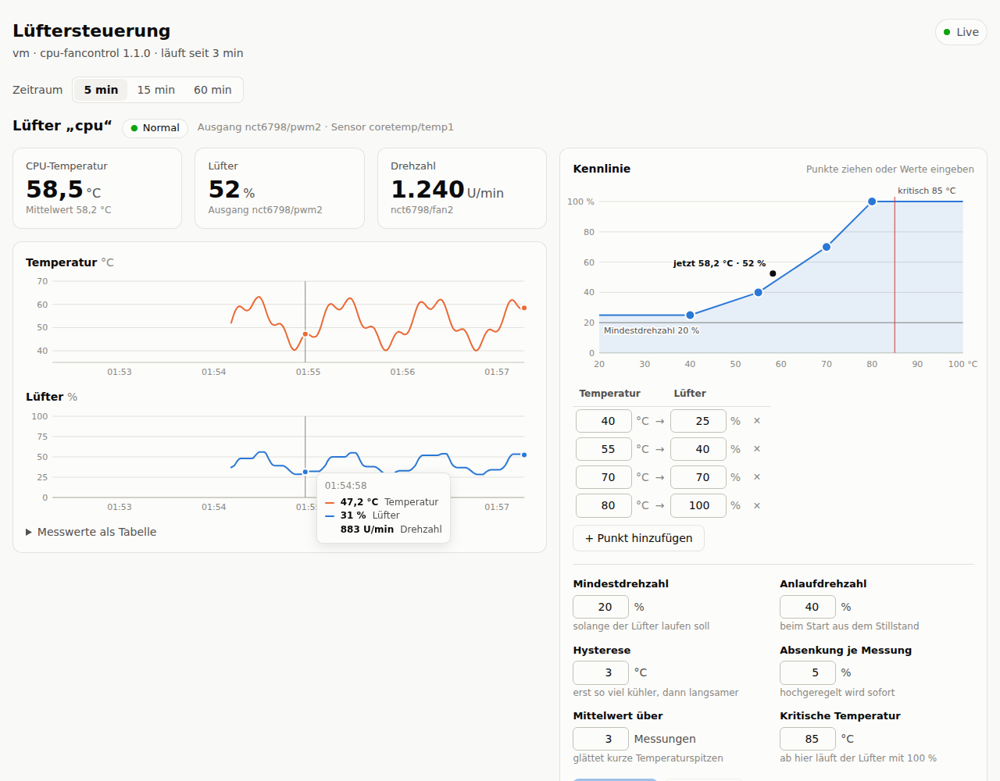

# cpu-fancontrol – CPU-Lüftersteuerung für Ubuntu-Server

Regelt den CPU-Lüfter (und bei Bedarf weitere Lüfter) eines Ubuntu-Rechners anhand
der CPU-Temperatur. Das Programm läuft als systemd-Dienst und benötigt nur Python 3
ohne zusätzliche Pakete.



- **Weboberfläche** unter `http://<server>/fan/`: Live-Werte, Verlauf der letzten Stunde, Kennlinie per Maus
  bearbeiten, Änderungen werden sofort übernommen
- **Frei einstellbare Kennlinie** (Temperatur → Drehzahl), linear interpoliert
- **Hysterese, Mittelwert und gebremstes Herunterregeln**, damit der Lüfter nicht ständig auf- und abdreht
- **Mindest- und Anlaufdrehzahl** für Lüfter, die bei niedriger PWM stehen bleiben
- **Fail-safe:** Bei kritischer Temperatur, Sensorfehler oder unplausiblen Werten läuft der Lüfter mit 100 %.
  Beim Beenden geht die Steuerung an das Mainboard zurück, auch nach einem Absturz.
- **Stabile Namen:** Sensoren werden über ihren Chip-Namen angesprochen (`coretemp/temp1`) statt über
  `hwmonN`-Nummern, die sich beim Booten ändern können
- **Hilfen für die Einrichtung:** Mit `list` siehst du alle Sensoren, mit `test` findest du heraus,
  an welchem Ausgang der CPU-Lüfter hängt
- Warnt im Log, wenn der Lüfter trotz Ansteuerung steht

Getestet mit Python 3.10 und 3.12 (Ubuntu 22.04 / 24.04). Ab Python 3.8 sollte es ebenfalls laufen.

## Voraussetzungen

- Ein **4-Pin-PWM-Lüfter** am CPU-Lüfteranschluss des Mainboards
- Ein Mainboard, dessen Lüfter-Chip einen Linux-Treiber hat (bei normalen PC-Mainboards fast immer:
  Nuvoton `nct6775`, ITE `it87`, Fintek `f71882fg` …)

> **Echte Server-Mainboards mit BMC/IPMI** (Supermicro, Dell iDRAC, HPE iLO …) steuern die Lüfter
> über den BMC. Sie haben meistens keine PWM-Ausgänge unter Linux. Dort stellst du die Lüfter per
> `ipmitool` bzw. in der BMC-Oberfläche ein, dieses Programm hilft dann nicht.

## 1. Sensor-Treiber laden

Prüfen, ob PWM-Ausgänge vorhanden sind:

```bash
ls /sys/class/hwmon/hwmon*/pwm[0-9]
```

Wenn hier nichts erscheint, ist der Treiber für den Lüfter-Chip noch nicht geladen:

```bash
sudo apt install lm-sensors
sudo sensors-detect            # alle Fragen mit ENTER bestätigen, am Ende "yes" zum Eintragen in /etc/modules
sudo modprobe nct6775          # den Treiber laden, den sensors-detect am Ende nennt (z.B. nct6775 oder it87)
```

Steht dann im Kernel-Log (`sudo dmesg | grep -i -e nct -e it87`) etwas von einem **ACPI-Ressourcenkonflikt**,
hilft als letzte Möglichkeit der Kernel-Parameter `acpi_enforce_resources=lax`. Du trägst ihn in
`/etc/default/grub` bei `GRUB_CMDLINE_LINUX_DEFAULT` ein und führst danach `sudo update-grub` aus und
startest neu. Neuere ITE-Chips brauchen eventuell den externen Treiber
[it87 (frankcrawford)](https://github.com/frankcrawford/it87) per DKMS.

## 2. Installieren

```bash
git clone https://github.com/fabmue98/rfhack.git
cd rfhack/ubuntu-fan-control
sudo ./install.sh
```

Das Skript installiert:

| Datei | Zweck |
|---|---|
| `/usr/local/sbin/cpu-fancontrol` | das Programm |
| `/usr/local/share/cpu-fancontrol/index.html` | die Weboberfläche |
| `/etc/cpu-fancontrol.conf` | Konfiguration (eine vorhandene Datei wird nie überschrieben) |
| `/etc/systemd/system/cpu-fancontrol.service` | systemd-Dienst |

Läuft auf dem Server Apache, bietet das Skript an, die Weboberfläche dort unter `/fan` einzubinden.
Bei nginx legt es ein Snippet an, das du in die Seite einbindest (siehe [Weboberfläche](#6-weboberfläche)).
Der Dienst wird erst aktiviert, wenn du ihn in Schritt 5 einschaltest.

## 3. CPU-Lüfter finden

```bash
cpu-fancontrol list
```

```
coretemp  (hwmon1, Gerät coretemp.0)
  coretemp/temp1                      48.0 °C  Package id 0
  coretemp/temp2                      46.0 °C  Core 0

nct6798  (hwmon2, Gerät nct6775.656)
  nct6798/fan1                      870 U/min
  nct6798/fan2                     1027 U/min
  nct6798/pwm1                     153 (60 %)  Betriebsart 5 (automatisch)
  nct6798/pwm2                     100 (39 %)  Betriebsart 5 (automatisch)
```

Welcher `pwm`-Ausgang zum CPU-Lüfter gehört, findest du mit `test` heraus. Das Programm senkt dabei die
Drehzahl schrittweise von 100 % auf 0 %, beobachtet alle Drehzahlsensoren und schlägt danach passende
Werte vor. Die CPU-Temperatur wird überwacht: Ab 80 °C bricht der Test ab (änderbar mit `--max-temp`).
Am Ende wird der ursprüngliche Zustand wiederhergestellt, auch bei Abbruch mit Strg+C.

```bash
sudo cpu-fancontrol test nct6798/pwm2
```

```
  PWM     nct6798/fan1    nct6798/fan2   CPU
  100 %       870 U/min      2000 U/min   48.0 °C
   75 %       870 U/min      1598 U/min   48.0 °C
   ...
   10 %       870 U/min         0 U/min   48.0 °C
    0 %       870 U/min         0 U/min   48.0 °C

→ nct6798/pwm2 steuert nct6798/fan2: 2000 U/min bei 100 %, läuft bis 20 %, darunter bleibt er stehen; startet ab 40 % wieder

Vorschlag für /etc/cpu-fancontrol.conf:
  pwm = nct6798/pwm2
  fan = nct6798/fan2
  min_pwm = 30
  start_pwm = 50
```

Reagiert kein Lüfter, testest du nacheinander die anderen `pwmN`-Ausgänge.

## 4. Konfigurieren

```bash
sudo nano /etc/cpu-fancontrol.conf
```

Mindestens `pwm` musst du anpassen. Alle Optionen sind in der Datei kommentiert:

| Option | Standard | Bedeutung |
|---|---|---|
| `interval` | `2` | Messintervall in Sekunden (Abschnitt `[general]`) |
| `on_exit` | `restore` | Beim Beenden: `restore` gibt die Steuerung an das Mainboard zurück, `full` setzt 100 % (Abschnitt `[general]`) |
| `pwm` | – | PWM-Ausgang des Lüfters, z.B. `nct6798/pwm2` |
| `sensors` | – | `auto` (Intel: Package-Temperatur, AMD: Tctl) oder z.B. `coretemp/temp1`, `k10temp/Tctl`. Bei mehreren Sensoren zählt der höchste Wert |
| `fan` | – | optionaler Drehzahlsensor zur Überwachung, z.B. `nct6798/fan2` |
| `curve` | `40:25, 55:40, 70:70, 80:100` | Kennlinie `Temperatur:Prozent`. Mit `0` darf der Lüfter stehen bleiben |
| `min_pwm` | `20` | Mindestdrehzahl in %, solange der Lüfter laufen soll |
| `start_pwm` | `40` | Anlaufdrehzahl in % aus dem Stillstand |
| `hysteresis` | `3` | Die Drehzahl sinkt erst, wenn die Temperatur um so viele °C gefallen ist |
| `ramp_down_step` | `5` | maximale Absenkung in % pro Intervall (hochgeregelt wird sofort) |
| `average` | `3` | gleitender Mittelwert über so viele Messungen |
| `critical_temp` | `85` | ab dieser Temperatur sofort 100 % |

Für weitere Lüfter, zum Beispiel Gehäuselüfter, legst du zusätzliche Abschnitte `[fan:<name>]` an.
Die Optionen der Weboberfläche (Abschnitt `[web]`) beschreibt [Abschnitt 6](#6-weboberfläche).

Danach prüfen:

```bash
sudo cpu-fancontrol check
```

Ohne Eingriff in die Lüfter kannst du die Regelung so beobachten: `sudo cpu-fancontrol run --dry-run -v`.

## 5. Dienst starten

```bash
sudo systemctl enable --now cpu-fancontrol
systemctl status cpu-fancontrol
journalctl -u cpu-fancontrol -f       # Log verfolgen
```

Nach Änderungen an der Konfiguration: `sudo systemctl restart cpu-fancontrol`.

Ins Log schreibt der Dienst nur Änderungen ab 10 % sowie Warnungen. Ein Beispiel:

```
cpu-fancontrol 1.1.0 gestartet – [cpu] nct6798/pwm2 nach coretemp/temp1
Weboberfläche auf http://127.0.0.1:8077/fan/
[cpu] 48.0 °C → Lüfter 33 % (1027 U/min)
[cpu] 75.0 °C → Lüfter 85 % (1391 U/min)
Warnung: [cpu] Kritische Temperatur 90.0 °C – Lüfter auf 100 %
```

## 6. Weboberfläche

Die Oberfläche zeigt für jeden Lüfter:

- CPU-Temperatur, Lüfterleistung und Drehzahl live, dazu einen Status (Normal, kritische Temperatur,
  Sensorfehler, Lüfter steht)
- den Verlauf von Temperatur und Lüfter über 5, 15 oder 60 Minuten. Fährst du mit der Maus über den Verlauf,
  siehst du die genauen Werte; alternativ gibt es eine Tabellenansicht.
- die **Kennlinie** mit dem aktuellen Betriebspunkt. Die Punkte kannst du mit der Maus ziehen oder in der
  Tabelle eintippen; außerdem lassen sich alle Einstellungen (Mindestdrehzahl, Hysterese, kritische
  Temperatur …) ändern. **Speichern** prüft die Werte, schreibt sie in `/etc/cpu-fancontrol.conf` und der
  Dienst übernimmt sie sofort, ohne Neustart. Kommentare in der Datei bleiben erhalten.

PWM-Ausgang und Sensoren lassen sich aus Sicherheitsgründen nur in der Konfigurationsdatei ändern.

### So wird sie unter `/fan` erreichbar

Der Dienst enthält einen kleinen Webserver, der nur lokal auf `127.0.0.1:8077` lauscht. Der Webserver,
der den KC-Manager ausliefert, leitet `/fan/` dorthin weiter. Die Oberfläche ist dann unter der
gewohnten Adresse plus `/fan` erreichbar, z.B. `http://192.168.1.10/fan/`, ohne den KC-Manager selbst
zu verändern.

**Apache:** `install.sh` erledigt das auf Nachfrage automatisch. Von Hand:

```bash
sudo cp web/apache-cpu-fancontrol.conf /etc/apache2/conf-available/cpu-fancontrol.conf
sudo a2enmod proxy proxy_http
sudo a2enconf cpu-fancontrol
sudo systemctl reload apache2
```

Leitet der KC-Manager-VirtualHost selbst alles per `ProxyPass / …` weiter, muss die Zeile
`ProxyPass /fan/ http://127.0.0.1:8077/fan/` **vor** dieser Regel im VirtualHost stehen.

**nginx:** `install.sh` legt `/etc/nginx/snippets/cpu-fancontrol.conf` an. Füge im `server { }`-Block
der KC-Manager-Seite (meist in `/etc/nginx/sites-enabled/`) diese Zeile hinzu:

```nginx
include snippets/cpu-fancontrol.conf;
```

Danach `sudo nginx -t && sudo systemctl reload nginx`.

**Anderer Proxy (Caddy, Nginx Proxy Manager, Traefik …):** Den Pfad `/fan/*` an `http://127.0.0.1:8077`
weiterleiten, ohne den Pfad zu kürzen. Läuft der Proxy in Docker, ist `127.0.0.1` der Container selbst.
Dann in `/etc/cpu-fancontrol.conf` `listen = 0.0.0.0` setzen und die IP des Servers als Ziel eintragen.

**Ohne Proxy:** Mit `listen = 0.0.0.0` ist die Oberfläche direkt unter `http://<server>:8077/fan/` erreichbar.

### Einstellungen (`[web]`)

| Option | Standard | Bedeutung |
|---|---|---|
| `enabled` | `no` (Beispielkonfiguration: `yes`) | Weboberfläche ein/aus |
| `listen` | `127.0.0.1` | Adresse des eingebauten Webservers (`0.0.0.0` = im ganzen Netz) |
| `port` | `8077` | Port des eingebauten Webservers |
| `path` | `/fan` | Unterordner der Oberfläche |
| `password_hash` | – | Passwortschutz, wird mit `sudo cpu-fancontrol passwd` gesetzt |

Nach Änderungen an `port` oder `path` die Proxy-Konfiguration entsprechend anpassen.

### Passwort

Wer die Seite erreicht, kann die Lüftereinstellungen ändern. Ist sie im Netz erreichbar, setze ein Passwort:

```bash
sudo cpu-fancontrol passwd            # Passwort setzen (Benutzername bei der Anmeldung beliebig)
sudo cpu-fancontrol passwd --remove   # Passwort entfernen
sudo systemctl restart cpu-fancontrol
```

Gespeichert wird nur ein gesalzener Hash (PBKDF2). Das Passwort wird per HTTP-Basic-Auth übertragen. Ist
der KC-Manager über HTTPS erreichbar, ist auch `/fan` verschlüsselt; bei reinem HTTP solltest du die Seite
nur im eigenen Netz nutzen.

## Sicherheit

- Bevor der Dienst übernimmt, sichert er den ursprünglichen Zustand der PWM-Ausgänge in
  `/run/cpu-fancontrol.state`. Beim Beenden stellt er diesen Zustand wieder her. Wird der Prozess hart beendet
  (`kill -9`, OOM), übernimmt das `cpu-fancontrol restore`, das systemd über `ExecStopPost` aufruft.
- Ist ein Temperatursensor nicht lesbar oder liefert er unplausible Werte, läuft der Lüfter mit 100 %.
- Ab `critical_temp` läuft der Lüfter sofort mit 100 %, ohne Mittelwert und ohne Verzögerung.
- Stellt etwas anderes (z.B. das BIOS nach dem Aufwachen aus dem Standby) die Betriebsart um, übernimmt
  der Dienst sie wieder und schreibt eine Warnung ins Log.
- Ein Lock verhindert, dass zwei Instanzen oder `test` und der Dienst gleichzeitig dieselben Lüfter steuern.
- Die Weboberfläche ist ein Zusatz: Startet sie nicht (z.B. weil der Port belegt ist), regelt der Dienst die
  Lüfter trotzdem. Werte aus der Oberfläche werden vor dem Speichern genauso geprüft wie die Datei; die
  Notabschaltung über `critical_temp` (höchstens 120 °C) bleibt immer aktiv.
- Läuft auch der Dienst `fancontrol` aus dem Paket `fancontrol`, warnt das Installationsskript, denn beide
  würden dieselben Lüfter steuern.

## Fehlerbehebung

| Problem | Lösung |
|---|---|
| `list` zeigt keine `pwm`-Ausgänge | Treiber laden, siehe Abschnitt 1 |
| `test`: kein Lüfter reagiert | Anderen `pwmN` testen. Im BIOS den Anschluss auf **PWM-Modus** stellen (nicht DC). 3-Pin-Lüfter lassen sich nur im DC-Modus regeln |
| Lüfter dreht trotz geänderter Werte nicht anders | Manche Mainboards ignorieren Schreibzugriffe; das BIOS-Lüfterprofil auf „Full Speed“ oder „Manual“ stellen hilft oft |
| Log meldet „0 U/min“ | `min_pwm` und `start_pwm` erhöhen (Werte aus `test` übernehmen) oder den Lüfter prüfen |
| `Chip 'xyz' nicht gefunden` | Name mit `cpu-fancontrol list` vergleichen. Bei zwei gleichnamigen Chips (z.B. Dual-CPU) die Geräte-ID verwenden, z.B. `coretemp.1/temp1` |
| Dienst startet nicht | `journalctl -u cpu-fancontrol -b` lesen. Konfigurationsfehler (Exit-Code 2) führen zu keinem automatischen Neustart |
| `/fan` zeigt den KC-Manager oder „404“ | Proxy-Regel fehlt oder kommt zu spät, siehe [Weboberfläche](#6-weboberfläche). Test direkt auf dem Server: `curl http://127.0.0.1:8077/fan/api/status` |
| `/fan` meldet „502 Bad Gateway“ | Der Dienst läuft nicht oder `[web] enabled` steht auf `no`: `systemctl status cpu-fancontrol` |
| Oberfläche zeigt „Keine Verbindung“ | Dienst wurde beendet oder neu gestartet. Die Seite verbindet sich automatisch wieder |

## Deinstallieren

```bash
sudo ./install.sh uninstall
```

Der Dienst wird gestoppt, die Lüfter gehen zurück an das Mainboard und die Apache-Einbindung wird
entfernt. `/etc/cpu-fancontrol.conf` bleibt erhalten. Eine nginx-`include`-Zeile musst du selbst entfernen.

## Tests

Die Tests bilden `/sys/class/hwmon` in einem temporären Ordner nach und brauchen weder root noch echte Hardware:

```bash
python3 -m unittest discover -s tests -v
```
